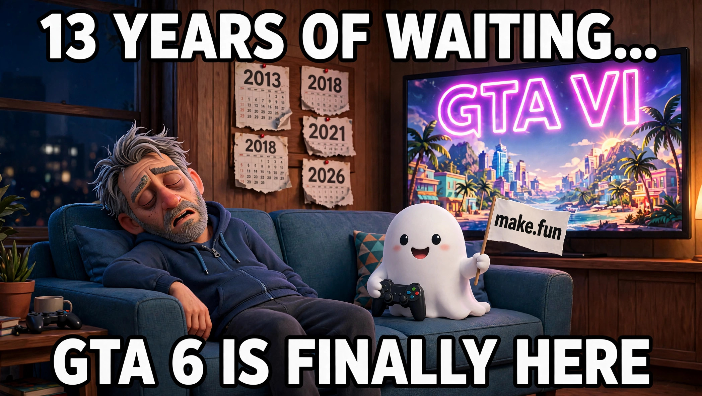

# 13 Years of Waiting... GTA 6 Is Finally Here

An entry for the make.fun bounty **[Post a GTA 6 meme on X](https://make.fun/bounty/gta6-meme-x-01)**.

## The meme

A GTA fan started waiting for GTA 6 back in 2013 — and waited, and waited. Thirteen years later he has grey hair, he has fallen asleep on the couch in front of the TV, and the wall behind him is covered in torn calendars spanning 2013 to 2026. But the wait is over: the TV glows with a neon "GTA VI" over a sunny tropical skyline, and sitting next to him on the couch is the make.fun ghost, wide awake, controller in hand, waving a little "make.fun" flag. The joke: the ghost waited with him — and it is the one still awake to play.

- Top caption: **"13 YEARS OF WAITING..."**
- Bottom caption: **"GTA 6 IS FINALLY HERE"**

## Why this angle

GTA V came out in 2013. GTA 6 was announced, delayed, delayed again — and finally released on 19 November 2026. Every GTA fan knows the feeling of checking the news for years and growing older while waiting. This meme turns that shared 13-year wait into one image: the fan fell asleep waiting, but the game is finally here, and the make.fun ghost is ready to play it with him.

## The X post

The meme was posted on X from a public account; the post is named in `POST.json` at the root of this repository (added after the post went live).

## How it was made

The image is 100% original AI-generated artwork, made with an image-generation model in a single recorded agent session. No Rockstar artwork, no screenshots, and no copyrighted GTA assets were used — the skyline, the characters, and the ghost are all original. The image was generated, visually inspected, and then revised once (bigger make.fun ghost, bolder "make.fun" flag, an added 2021 calendar) before being saved as `meme.jpg`.

## License

MIT — see [LICENSE](LICENSE).
